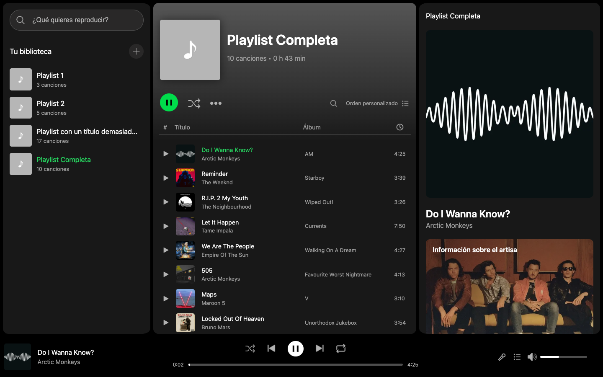
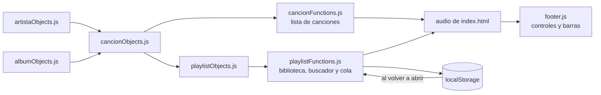

<div align="center">

# 🎧 Spotify, hecho a mano

**Un reproductor de música inspirado en Spotify, construido desde cero con HTML, CSS y JavaScript puro.**
Sin frameworks, sin librerías y sin instalar nada.




</div>

> [!NOTE]
> Es un proyecto personal de aprendizaje, sin relación con Spotify. Lee el [aviso legal](#-aviso-legal) antes de reutilizar nada.

## ✨ Qué puedes hacer

| | Función | Cómo funciona |
|---|---|---|
| ▶️ | **Reproducir** | Play, pausa, anterior y siguiente; play y pausa también responden a las teclas multimedia |
| 📚 | **Playlists** | Abre las que hay o crea una nueva con el botón `+` |
| 🔎 | **Buscar** | Filtra canciones mientras escribes y añádelas a una playlist desde una ventana con su propio buscador |
| 📜 | **Cola** | Mira qué suena, qué viene después y lo que has escuchado hace poco |
| 🎤 | **Letras** | Se muestran con el botón del micrófono; ahora mismo solo hay una canción con letra |
| 🔁 | **Repetir** | Pon la canción actual en bucle |
| 🔊 | **Volumen** | Barra de volumen y botón de silencio |
| 🎨 | **Detalles** | Portada del álbum, ficha del artista y fondo de la letra con el color del álbum |
| 💾 | **Memoria** | Al volver, recuerda la última playlist abierta y la última canción guardada |

## 🚀 Ponlo en marcha

Necesitas un servidor local, porque el navegador bloquea los módulos de JavaScript si abres `index.html` con doble clic: la lista saldría vacía.

```bash
git clone https://github.com/PabloFonseca30/Spotify.git
cd Spotify
python3 -m http.server 8000
```

Después abre **http://localhost:8000**, entra en una playlist y pulsa el botón verde de play.

> [!TIP]
> `http.server` no permite saltar a otro punto de la canción: al pulsar en la barra de progreso, el audio sigue donde estaba. Para eso hace falta un servidor con peticiones *Range*, como la extensión Live Server de VS Code o `npx serve`.

## 🧠 Cómo funciona por dentro

No hay base de datos ni servidor propio. Las canciones, los artistas, los álbumes y las playlists son objetos de JavaScript, y la interfaz se dibuja a partir de ellos.



```text
Spotify/
├── index.html              La estructura de la página
├── css/                    Estilos de cada zona
├── js/
│   ├── artista/            Clase Artist y lista de artistas
│   ├── album/              Clase Album y lista de álbumes
│   ├── cancion/            Clase Song, lista de canciones y letras
│   ├── playlist/           Playlists, buscador, cola y letras en pantalla
│   ├── footer.js           Play, barras de progreso y volumen, repetir
│   └── localStorage.js     Guarda y recupera la sesión
└── src/
    ├── audios/             Los archivos de sonido
    ├── icons/              Iconos de la interfaz
    └── images/             Portadas, fotos de artistas y logo
```

La cola es un array: `playNextSong()` pasa la canción actual al historial y carga la siguiente cuando el audio emite el evento `ended`. La sesión se guarda en `localStorage` con dos claves, `lastPlayedSong` y `currentPlaylist`.

## 🎵 Cambia las canciones por las tuyas

Todo se hace en [`js/cancion/cancionObjects.js`](js/cancion/cancionObjects.js). Cada canción es una línea:

```js
new Song(1007, 'Maps', getArtistByName('Maroon 5'), getAlbumByName('V'), '3:10', 'src/audios/Maps.mp3'),
//       id    título  artista (nombre exacto)      álbum (nombre exacto) duración  archivo de audio
```

> [!IMPORTANT]
> Las playlists y las letras apuntan a las canciones por su **posición** en la lista (`canciones[0]` es la primera). Por eso sustituir es muy fácil, y borrar requiere un paso más.

### 🔄 Sustituir una canción

Es la forma más sencilla, porque la canción conserva su posición.

1. Copia tu audio en `src/audios/`, por ejemplo `mi_cancion.mp3`.
2. Cambia su línea en `cancionObjects.js`:
   ```js
   new Song(1007, 'Mi canción', getArtistByName('Maroon 5'), getAlbumByName('V'), '3:25', 'src/audios/mi_cancion.mp3'),
   ```
3. Borra el audio antiguo de `src/audios/`.
4. Si sustituyes la segunda canción (*Reminder*), borra también las líneas `canciones[1].lyrics.push(...)`, porque esa letra es suya.
5. [Limpia los datos guardados](#-limpia-los-datos-guardados).

La duración que escribes es solo el texto de la lista y del total de la playlist. El reproductor lee la duración real del archivo.

### 🗑️ Borrar una canción

1. Borra su línea `new Song(...)` y su archivo de `src/audios/`.
2. En [`js/playlist/playlistObjects.js`](js/playlist/playlistObjects.js), quita los `canciones[N]` de esa canción y **resta 1 a los de las canciones que iban detrás**.
3. Haz lo mismo con el número de `canciones[1].lyrics.push(...)` si cambia su posición.
4. [Limpia los datos guardados](#-limpia-los-datos-guardados).

Si te saltas el paso 2, la playlist afectada dará un error al abrirla (`Cannot read properties of undefined`).

### 🧹 Quitar todas las canciones

1. Borra la carpeta `src/audios/`.
2. Deja la lista vacía en `cancionObjects.js` (`const canciones = [];`) y quita todas las líneas `canciones[1].lyrics.push(...)`.
3. Quita todas las líneas `playlists[N].canciones.push(...)` de `playlistObjects.js`.
4. [Limpia los datos guardados](#-limpia-los-datos-guardados).

La app sigue abriéndose, con las playlists vacías.

### ➕ Añadir artistas y álbumes

Una canción nueva puede necesitarlos. Añade una línea en cada archivo, usa imágenes tuyas y escribe el nombre igual que en `getArtistByName()` y `getAlbumByName()`:

```js
// js/artista/artistaObjects.js:   id, nombre, descripción, oyentes, foto
new Artist(9009, 'Mi grupo', 'Una banda de mi barrio.', '1.234', 'src/images/banner/mi_grupo.webp'),

// js/album/albumObjects.js:       id, nombre, color de fondo de la letra ("unset" para gris), portada
new Album(7011, 'Mi disco', '#345b8aff', 'src/images/album/mi_disco.webp'),
```

### 🧽 Limpia los datos guardados

El navegador recuerda la última canción y playlist, así que puede seguir mostrando las antiguas. Abre la consola con `F12`, ejecuta esto y recarga sin caché (`Ctrl`+`Shift`+`R`, o `Cmd`+`Shift`+`R` en Mac):

```js
localStorage.clear();
```

### 🕰️ Borrar los audios también del historial

Un commit que borra un archivo no lo elimina de los commits anteriores: se podría seguir descargando desde ellos. Para quitarlo del todo hay que reescribir el historial, por ejemplo con [`git filter-repo`](https://github.com/newren/git-filter-repo), y hacer un `git push --force`.

## 🚧 Limitaciones conocidas

- **Aleatorio y orden personalizado:** los botones aún son solo visuales.
- **Repetir:** solo funciona el bucle de la canción. El modo de repetir la lista cambia el icono, pero no hace nada más.
- **Lo que no se guarda:** las playlists nuevas y las canciones que añades a una playlist se pierden al recargar la página.
- **Canción sin cola:** si pulsas una fila antes de usar el play verde de la playlist, suena bien, pero sale un error en la consola, no se actualiza la cola y esa canción no queda guardada.
- **Letras:** solo *Reminder* tiene letra.
- **`PRUEBA.mp3`:** es un audio que no usa ninguna canción.

## 🧾 Aviso legal

Este proyecto es personal y educativo, y no está afiliado, respaldado ni patrocinado por Spotify. «Spotify» y su identidad visual pertenecen a sus propietarios.

Los audios, las letras, las portadas y las fotos de artistas de este repositorio pertenecen a sus respectivos titulares, y este repositorio no concede ningún permiso para usarlos. Si eres titular de alguno de estos contenidos y quieres que se retire, abre un *issue* y lo quitaré.

Iconos de [Icons8](https://icons8.com).
